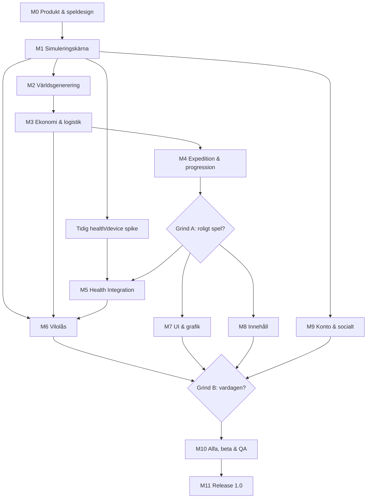

# ARKIPELAGEN — Roadmap till version 1.0

> **Dokumentstatus:** Utkast v0.1 — agentöverlämning  
> **Datum:** 2026-10-17  
> **Produktkrav:** [PRD.md](./PRD.md)  
> **Planeringsprincip:** **kvalitetsstyrda milstolpar, inte kalenderstyrd featurejakt.** Utvecklingstid och arbetsinsats är inte begränsande faktorer; arkitektoniska genvägar och halvfärdiga system är inte acceptabla.

## 0. Hur roadmapen används

Denna roadmap är en ordnad **leverans- och beroendeplan**, inte en lista med datum eller en order att koda alla funktioner i ordning. Varje milstolpe har:

- **Mål:** vilket produkt-/teknikproblem den löser.
- **Leverabler:** vilka artefakter, funktioner och verktyg som ska finnas.
- **Kvalitetsgrind:** vad som måste vara verifierat innan delen godkänns.
- **Beroenden:** vilka föregående beslut/system som måste vara stabila.

Vi använder en *vertikal, testbar spelkärna* tidigt för att motverka risken att alla moduler blir tekniskt färdiga men spelet inte är roligt. Fristående bibliotek, grafik, integrationer och innehåll kan tas fram parallellt. **Det finns inga artificiella deadlines eller veckoprognoser i denna första version.** Estimat kan läggas till först om de behövs för faktisk bemannings-/kostnadsplanering.

### Statusar

`NOT_STARTED` → `IN_PROGRESS` → `IN_REVIEW` → `ACCEPTED`.  
Om en milstolpe inte klarar sin kvalitetsgrind återgår den till `IN_PROGRESS` med dokumenterade observationer och återstående arbetsuppgifter.

### Releasefasernas övergripande grindar

| Grind | Omfattning | Vad den bevisar |
|---|---|---|
| **A — Spelet är roligt** | M0–M4 | Strategisk kärna med meningsfulla beslut, helt utan hälsointegration |
| **B — Fungerar i vardagen** | M5–M9 | Fungerande hälsodata, absolut vilolås, bra mobil-UX och driftbar plattform |
| **C — Förtjänar release** | M10–M11 | Balanserat, säkert, stabilt och verifierat för verkliga användare |

---

## 1. Milstolpsöversikt

| Milstolpe | Namn | Huvudberoende | Leveranstillstånd |
|---|---|---|---|
| M0 | Produkt- och speldesign | Beslut D-01–D-09 | NOT_STARTED |
| M1 | Teknik- och simulationsgrund | M0 kärnregler | NOT_STARTED |
| M2 | Kartmotor och världsgenerering | M1 kärnmodeller | NOT_STARTED |
| M3 | Civilisation, produktion och logistik | M2 karta, M1 sim | NOT_STARTED |
| M4 | Expeditioner, forskning och kampanj | M3 ekonomi, M2 värld | NOT_STARTED |
| M5 | Hälsomotor och OS-integrationer | M1 adapterspike, M4 progression | NOT_STARTED |
| M6 | Vilolås och dygnscykel | M1 serverklocka, M3 arbetsmodell, M5 sync | NOT_STARTED |
| M7 | Slutlig UI/UX, grafik och ljud | M2–M6 spelbara flöden | NOT_STARTED |
| M8 | Innehåll, världshistoria och långlivad progression | M3–M4 system | NOT_STARTED |
| M9 | Konton, molnsynk och socialt spel | M1 plattform, M3–M6 regler | NOT_STARTED |
| M10 | Test, balansering, alfa och beta | M0–M9 funktionskomplett | NOT_STARTED |
| M11 | Releaseförberedelser och produktion | M10 godkänd | NOT_STARTED |

**Viktigt:** M1 inkluderar tidiga vertikala spikes för Health Connect/HealthKit och Godot native plugins även om full implementation ligger i M5. M6:s domäninvariant (vilolås) ska skrivas redan i M1, inte fogas på i slutet.

---

## 2. Detaljerade leveranser

### M0 — Produktvision, speldesign och validerad kärnloop

**Mål:** definiera vad som gör Arkipelagen roligt, samt vilka avvägningar som gör spelandet långsiktigt men hälsosamt.

**Arbete och leverabler**

1. Godkänn produktvision, primär målgrupp, designprinciper och V1-scope i PRD.
2. Specificera aktiv daglig loop, återkomst efter frånvaro och nattens låsta tillstånd.
3. Definiera minst tre strategiskt olika vägar genom en spelkampanj.
4. Specificera begrepp: resurs, recept, arbete, byggnad, lager, bosättning, expedition, region, forskning, vila.
5. Rita tre UX-resor: första dagen, återkomst efter 7 dagar, kväll med nattlås.
6. Skriv första ekonomidesignen med ungefär 8–12 representativa byggnader och fulla produktionskedjor.
7. Gör en **headless/pappersbar prototyp** som visar varför vägnät, lager och byggplats spelar roll.
8. Definiera kampen mot FOMO, förlorad streak och hälsoprestationspress med konkreta förbud och tester.
9. Ta fram art direction, UI-wireframes och tydlig spelkarta i enklare mockup.
10. Öppna och prioritera ADR:er för kritiska arkitekturval samt produktbeslutslogg.

**Artefakter:** `VISION.md`, `GAME_DESIGN.md`, `ECONOMY_MODEL.md`, `UX_FLOWS.md`, `DECISIONS.md`, prototyp och reviderad PRD.

**Kvalitetsgrind A0:** minst tre olika strategier kan demonstreras och utvärderas. Det går att beskriva en hel dag inklusive vila. Inga kritiska gameplayregler kräver att användaren delar hälsodata. Inga grundläggande öppna frågor blockerar utveckling av simuleringsmotorn.

**Beroenden:** inga utöver fastställda produktbeslut.

### M1 — Arkitektur, CI/CD, datamodell och simuleringskärna

**Mål:** bygga ett testbart, reproducerbart och uppgraderbart fundament för ett långlivat spel.

**Arbete och leverabler**

1. Besluta klient/backend-stack efter prototyp och device-spike (kandidat: Godot/GDScript, Kotlin, Swift, Spring Boot/Java, PostgreSQL).
2. Skapa monorepo eller tydlig fler-repostruktur med API-kontrakt, byggautomation, kvalitetsgrindar, versionspolicy och dependency scanning.
3. Implementera domänmodeller, `GameCommand`, `GameEvent`, kommando-ID, idempotens, optimistic concurrency och behörighetskontroll.
4. Implementera deterministisk, headless simuleringsmotor med virtuell klocka och versionshanterade regeluppsättningar.
5. Fastställ serverauktoritativ tid, simulation fast-forward, snapshot-strategi och eventjournal.
6. Definiera offline-beteende. Föreslaget V1-beslut: skrivskyddad cache när backend saknas.
7. Skapa minsta möjliga Android-/iOS-app med fungerande distribution till fysiska testtelefoner.
8. Bygg ett minimalt native integrationstest för Health Connect och HealthKit: tillståndsfråga, läsning av testdata och livscykelhändelse.
9. Implementera migrationsramverk och exempel på framåt-/bakåtkompatibel dataläsning.
10. Bestäm tidiga mätbudgetar och target device matrix (minne, batteri, fps, API-latens, starttid).

**Artefakter:** körbart repo, CI, automatiserade tester, devmiljö, arkitekturdiagram, `API_CONTRACTS.md`, ADR:er, migrationsplan, device-spike-rapport.

**Kvalitetsgrind A1:** headless replay är deterministisk; dubblettkommando förändrar inte tillstånd två gånger; ett nattscenario kan blockera spelkommandon på server; Android- och iOS-demo kör på enhet; systemet klarar versionsuppgradering av ett enkelt tillstånd.

**Beroenden:** M0 kärnregler. Kan parallelliseras med fortsatt GDD- och art-arbete.

### M2 — Fiktiv karta, hexgeometri och reproducerbar världsgenerering

**Mål:** göra geografin till en verklig strategisk resurs och förbereda byte av kartkälla.

**Arbete och leverabler**

1. Implementera axiala hexkoordinater, grannrelationer, area-sökning, höjd, gångbarhet och nav/topologi.
2. Inför `WorldGenerator`-gränssnitt och versionerat, serialiserbart `WorldMap`-format.
3. Procedurgenerera öar, hav, kust, floder, berg, skogar, odlingsbar mark, naturliga passager och regionala resurser.
4. Skapa validator för rimliga startförutsättningar och tillräckliga expansionsvägar.
5. Spara kartans faktiska tillstånd och kunna återskapa exakta äldre världar.
6. Lägg till dimma/upptäckt, långsam avslöjning, minikarta, zoom, panorering och urvalsverktyg.
7. Skapa testgenerator med bulk-validering och utvecklarverktyg för att studera problematiska seeds.
8. Förbered `sourceType=GEOGRAPHIC` i datamodellen utan att implementera geodataimport.

**Artefakter:** kartmotor, kartgenerator, visualiseringsdemo, världformatsspecifikation, generatorvalidator och seed-katalog för regressionsprov.

**Kvalitetsgrind A2:** tusentals seeds kan genereras och valideras automatiskt; kritiska topologiska fel rapporteras, inte göms; rendering och pathfinding fungerar på relevanta kartstorlekar; världar från gamla versioner kan laddas oförändrade.

**Beroenden:** M1 grundmodeller; UX och grafikarbete kan pågå parallellt.

### M3 — Bosättningar, invånare, resurser, produktion och logistik

**Mål:** leverera ett spelbart city builder-system med genuina optimeringsmöjligheter.

**Arbete och leverabler**

1. Byggplacering, grundning av bosättningar, områdeskontroll och uppgraderingsregler.
2. Resursrecept, insats-/utvaror, lagerkapacitet, producerad kvantitet, arbetstilldelning och konsumtion.
3. Invånarbehov, tillväxt och återhämtningsbara konsekvenser vid brist.
4. Vägar, lager, transportkapacitet, ruttval, hamnar och flödesbegränsningar.
5. Ekonomi- och logistikpaneler med tydliga orsaker till produktionsstopp.
6. Konkurrerande investeringar: nybyggnation vs effektivisering, närhet vs logistik, snabb avkastning vs långsiktigt nätverk.
7. Minst tre sammanhängande region-/bosättningsscenarier med olika optimala strategier.
8. Stresstesta simulationen under lång tid med tusentals byggnads-/transporthändelser.
9. Verktyg för ekonomisnapshot, replay, deterministisk jämförelse och genererad testdata.

**Artefakter:** komplett ekonomimotor, receptformat, byggnadsinnehåll, logistikmodell, diagnostikpaneler, simuleringstester.

**Kvalitetsgrind A3:** spelaren kan bygga ett sammanhängande samhälle och se tydlig ekonomisk effekt av placering och handel; systemet går inte sönder av långa offlineperioder, brister eller köade projekt; minst två strategier är fungerande och ingen är trivialt överlägsen i alla testscenarier.

**Beroenden:** M1, M2. Introducera nattschema som invariant i simuleringstesternas fixtures.

### M4 — Expeditioner, forskning, kampanj och spelbar vertical slice

**Mål:** slutföra spelets strategiska kärna från start till större mål, innan verklig hälsodata blir en beroendefaktor.

**Arbete och leverabler**

1. Expeditioners rutter, resurser, restid, fynd, risk och återrapportering.
2. Upptäcktslogik för regioner och särskilda intressepunkter.
3. Forskningsträd med prioriterade val och alternativa uppgraderingar.
4. Kampanjprogression med mål, delmål, introduktionsuppdrag och avslut.
5. System för världshändelser och bygg-/expeditionshistorik.
6. Sandbox-/fortsätt-spela-läge efter huvudsakligt kampanjmål.
7. Health-simulator/fake provider som låter testare köra olika vanoscenarier utan riktiga personuppgifter.
8. Genomför en komplett intern spelkampanj och iterera tills loop och beslut är engagerande.

**Artefakter:** spelbar vertical slice med headless hälsosignaler, progressionstest, kampanjtest och designuppföljning.

**Kvalitetsgrind A4 / GRIND A:** en extern testare kan förstå progressionen, spela igenom ett kampanjscenario och identifiera meningsfulla strategiska val. **Grundspelet ska vara roligt utan hälsodata.** Inga blockerande designproblem får skjutas vidare till grafik eller hälsointegration.

**Beroenden:** M2/M3. Visualisering och ljud kan utvecklas parallellt.

### M5 — Hälsomotor, rättvisa och native integrationer

**Mål:** säkert integrera flera hälsovanor som frivilliga, balanserade och tillförlitliga inputs.

**Arbete och leverabler**

1. Produktbeslut om exakt belöningsfunktion för steg, träning och sömn; definiera mjuka tak, neutral grundprogression och alternativ.
2. Android Health Connect: steg, träningspass, sömn där tillgängligt och godkänt.
3. iOS HealthKit: motsvarande funktion med plattformsanpassad tillståndsmodell.
4. Normalisera överlappande källor, korrigerade intervall, sen data, bortfall och upprepade importer.
5. Integrera ledger/idempotens mot auktoritativ spelmotorn utan rådatadump till central backend.
6. Hantera nej till behörighet, partiellt tillstånd, avinstallation av datakälla, frånkoppling och radering.
7. Testa olika aktivitetsnivåer, källkombinationer, sensorfria spelare och tillgänglighetsbehov.
8. Fastställ juridik-/privacykrav, dataflödeskarta, gallring och butikspolicycheck.

**Artefakter:** native adaptrar, normaliseringsbibliotek, Health Reward Engine, datalivscykeldokument, system- och enhetstester.

**Kvalitetsgrind B5:** båda plattformarna klarar tillstånds- och importflöden på riktiga enheter; ingen legitim dubbelbelöning; bortfall ger inte straff; hälsodata är frivillig; dataminimering och raderingsflöde har verifierats.

**Beroenden:** M1 native spike, M4 balansytor. Påbörja teknisk adapter parallellt redan från M1.

### M6 — Sömnrutin, dygnscykel och absolut spel-lås

**Mål:** realisera produktens särskiljande vilomekanik utan kryphål eller orimligt tvingande beteende.

**Arbete och leverabler**

1. Formalisera tillståndsmaskin `ACTIVE → PREPARING → RESTING → ACTIVE` och policy för spelkommandon.
2. Inför kanonisk tidslogik i backend med IANA-tidszoner och sommartidstester.
3. Implementera att bybornas produktion/arbetsköer pausar under vila, utan resursförlust.
4. Blockera gameplaykommandon i API/command handler, även om UI försöker kringgå.
5. Bygg nattvy, vilobudskap, upplåsning och tyst notisregim.
6. Tillåt administrativa rättigheter: integritet, kontouppgifter, stöd, radering och tillgänglighetsinställningar.
7. Definiera säker och begriplig ändring av schema för skiftarbete, resor och felinställningar.
8. Hantera sent inkommande hälsodata som köas och redovisas efter vila.
9. Testa offline-reconnect, tidsspoofing, parallella enheter och återstart av backend vid fasbyte.

**Artefakter:** domäninvariant, tidsmotor, API-guard, natt-UI, testmatris och användarstudie för schemainställningar.

**Kvalitetsgrind B6:** inget gameplaykommando passerar under vila; produktion är korrekt pausad; upplåsning kräver inte bevisad sömn; tidszons-/DST-/resa-/skiftscenarier är verifierade; nattläget upplevs lugnt i användartest.

**Beroenden:** M1 klocka, M3 produktion, M5 hälsosynk.

### M7 — Färdig spelupplevelse: grafik, ljud, UX och tillgänglighet

**Mål:** göra strategisystemen begripliga, attraktiva och behagliga i mobilformat.

**Arbete och leverabler**

1. Fastställ art bible: arkitektur, biomer, karaktärer, årstid, ljus, vyvinkel, färgpalett.
2. Skapa produktionspipeline för 2D/isometrisk/2.5D-konst och versionshanterade grafikresurser.
3. Färdigställ terräng, byggnadssteg, invånare, transporter, expeditioner, nattmiljö och visuella händelser.
4. Färdigställ huvud-UI: resursöversikt, byggkatalog, ekonomi, karta, forskning, rapport, konton, socialt.
5. Gör responsiv mobilnavigation, touch targets, zoom, panorering, undo där säkert, felmeddelanden.
6. Skapa stämningsfull musik, UI-ljud, nattambience och ljudinställningar.
7. Lokaliseringsflöde och språkgranskning för svenska/engelska.
8. Tillgänglighet: kontrast, skalbar text, reducerad animation, färgoberoende ikoner och läsbar information.
9. Utför strukturerad usabilitytestning med nya spelare och icke-utvecklare.

**Artefakter:** art bible, art pipeline, ljudpaket, färdigt UI-designsystem, lokaliseringsfiler, UX-rapport.

**Kvalitetsgrind B7:** kritiska handlingar går att hitta och genomföra utan extern instruktion; gameplay och nattvy håller samman visuellt; tillgänglighetsflöden är testade på målgruppsenheter; inga oacceptabla grafik-/prestandafel.

**Beroenden:** UX börjar M0, full integration efter M3–M6.

### M8 — Kurerat innehåll, återspelbarhet och historik

**Mål:** tillräcklig bredd och variation för att spelare inte ska tröttna efter den första veckans upptäckter.

**Arbete och leverabler**

1. Utöka balansgranskade byggnader, resurser, biomer, forskningsgrenar och produktionskedjor.
2. Skapa olika regionscenarier, kartintressepunkter, fynd och begränsade berättelsekedjor.
3. Bygg konsekvent historik: grundade städer, stora projekt, expeditioner, handelsvägar och monument.
4. Förstärk progression för vecka 2–8 och större kampanjmål.
5. Utvärdera återspelbarhet med varierande seed, startgeografi och strategier.
6. Bygg internt verktyg för content validation: saknade resurser, omöjliga recept, föräldralösa forskningsnoder, trasiga textnycklar.
7. Ge alla större händelser begripliga spelkonsekvenser och UI-förklaringar.

**Artefakter:** färdig innehållskatalog, innehållsvalidatorer, spelhistorik och full kampanj.

**Kvalitetsgrind B8:** en längre kampanj har kvalitativt varierade mål; inga nödvändiga innehållslåsningar förekommer; innehållsvalidering körs i CI; flera världar ger tydligt olika strategiska problem.

**Beroenden:** M3/M4; content tools kan påbörjas tidigt.

### M9 — Konto, molnsparning, socialt och driftfunktioner

**Mål:** ge säkra, varaktiga spelvärldar och frivilligt samarbete utan att påverka vilolås eller privat hälsodata.

**Arbete och leverabler**

1. Säker kontoskapning, inloggning, återställning och sessionshantering.
2. Auktoritativa sparningar, snapshots, migrering och konfliktupplösning vid flera enheter.
3. Säkerhetstesta API:er, IDOR, tids-/rollspoofing och transaktionella dubbelklick.
4. Frivilliga vänner och läsbara civilisationsbesök utan synlig privat hälsodata.
5. Ett litet men meningsfullt asynkront samarbetsprojekt med deltagar-/vilopolice.
6. Inför moderations-, blockerings- och rapporteringsflöden i den omfattning socialt kräver.
7. Observability, incidentrutiner, automatiserad backup, restore-övning och databasmigrering.
8. Utveckla onboarding av konton, användardataradering och supportdiagnostik utan hälsoinnehåll i loggar.

**Artefakter:** konto- och sociala moduler, driftmanual, incidentplan, restoreprotokoll, säkerhetsrapporter.

**Kvalitetsgrind B9 / GRIND B:** hela spelet fungerar på två riktiga plattformar och över kontobyte; inga dupliceringar eller informationsläckor; sociala funktioner är helt frivilliga; vila respekteras även i samarbeten; backup kan återställas.

**Beroenden:** M1, M3–M6.

### M10 — Systematisk QA, långsimulering, balansering och beta

**Mål:** bevisa att spelet fungerar under verkliga förhållanden och är värt spelarens långsiktiga uppmärksamhet.

**Arbete och leverabler**

1. Skapa komplett testmatris för domän, integration, mobil, backend, data, behörigheter och tidszoner.
2. Massimulera världar under år av speltid med låg/hög/ingen aktivitetsdata, olika strategier och olika scheman.
3. Kör mutation-/property-based-testning av ekonomiinvarianter, kommandoidempotens, generator och tid.
4. Belastningstesta API, snapshot/replay, reconnect och socialt projekt.
5. Profilera batteri, nätverk, minne, starttid och bilduppdatering på representativa verkliga enheter.
6. Kör stängd alfa med djupintervjuer om strategi, vilolås och vardagsanvändning.
7. Kör en långvarig beta (föreslaget 30–60 dagar) med testpersoner med varierande rutiner och datakällor.
8. Mät positiv motivation och eventuella negativa effekter: stress, tvångskänsla, förskjuten läggtid.
9. Validera ekonomibalans, rättvis progression, användbar onboarding och tydlig återkomstrapport.
10. Frys nytt innehåll vid releasekandidat och åtgärda blockerande/allvarliga fel.

**Artefakter:** test- och spelbalansrapporter, prestandabaslinjer, stabilitetsdashboards, beta-insikter, prioriterad bugglista och RC-bygge.

**Kvalitetsgrind C10:** komplett kampanj speltestad; inga blockerande/allvarliga fel; kvalitetsmått uppfyllda; vilolås och integritet fungerar på båda plattformar; användartester stödjer tesen att spelet är roligt utan överdriven tidspress.

**Beroenden:** M0–M9 tillräckligt färdiga för RC.

### M11 — Produktionsrelease 1.0

**Mål:** släppa en driftbar, juridiskt granskad och förvaltningsbar produkt.

**Arbete och leverabler**

1. Slutför varumärkesnamn, butikssidor, skärmbilder, trailer, release notes och supportmaterial.
2. Fullfölj aktuella deklarationer och policykrav för Health Connect/HealthKit, integritet, dataskydd och appbutik.
3. Gör extern eller oberoende säkerhetsgranskning av kritiska flöden och behandling av hälsodata.
4. Publicera och testa återställnings-, raderings-, integritets- och kontaktvägar.
5. Genomför katastrofåterställning, migrationstest, rollbackplan och change freeze inför produktion.
6. Verifiera rapporteringssystem och larm utan känsliga uppgifter i telemetry.
7. Genomför staged rollout med tydliga rollbackkriterier samt observera verkliga fel och resursförbrukning.
8. Godkänn den övergripande releasechecklistan och dokumentera kvarvarande icke-blockerande kända problem.
9. Skapa underhållsplan och separat backlog för 1.1 och geografiska kartor.

**Artefakter:** godkända store-builds, drift- och supportdokument, policybilagor, backup/restorebevis, release tag `v1.0.0` och post-release plan.

**Kvalitetsgrind C11 / RELEASE:** samtliga P0-krav och godkända P1-scopeuppgifter verifierade, inga releaseblockerare öppna, butikskraven uppfyllda och rollback/restore testat.

**Beroenden:** M10 godkänd och sign-off för säkerhet och integritet.

---

## 3. Parallella arbetsströmmar

| Ström | Påbörjas | Pågår huvudsakligen | Leveransfokus |
|---|---|---|---|
| **Gamedesign/balans** | M0 | M0–M10 | Ekonomi, strategi, forskning, health rewards och kampanj |
| **Kärnarkitektur/server** | M1 | M1–M11 | Tid, händelser, säkerhet, simulering och beständighet |
| **Klient/rendering/UX** | M0 | M1–M10 | Godot, kartvy, byggande, rapporter och tillgänglighet |
| **OS/hälsointegration** | M1 spike | M5–M10 | Permission UX, bakgrundsdata, synk och integritet |
| **Innehåll/konst/ljud** | M0 | M2–M10 | Världar, byggnader, animationer, berättelser och musik |
| **Drift/QA/privacy** | M1 | M1–M11 | CI, observability, dataflöden, test, restore och compliance |

En ström kan ha eget delgodkännande men **releasegrindarna är gemensamma**. Ingen får markera en feature som färdig om den saknar integrationstester, användarflöde eller relevant dokumentation.

---

## 4. Dependency map – vad blockerar vad?



*Mermaid-diagrammet är en förenklad bild av huvudsakliga beroenden, inte en kritisk-väg-beräkning. Tidiga designspikar gör att integrationer kan utvecklas parallellt.*

---

## 5. Förslag till epicstruktur och första backlog

För att en annan agent ska kunna bryta ned roadmapen direkt används följande epics. Varje issue ska länka till ett PRD-ID, minst ett verifierbart acceptanskriterium och en överordnad milstolpe.

| Epic | Milstolpe | Beskrivning | Relevanta PRD-ID |
|---|---|---|---|
| EP-01 | M0 | Spelregler, metaloop, balans och designbeslut | CIV-*, EXP-*, RES-*, PRG-* |
| EP-02 | M1 | Simulationsdomän, tid, kommandon, replay, snapshots | NFR-01/02/09/11, ACC-02 |
| EP-03 | M2 | Kartdata, generator, hexgeometri och rendering | MAP-01…09 |
| EP-04 | M3 | Byggsystem och produktion | CIV-01…08 |
| EP-05 | M3 | Logistik och handel | LOG-01…05 |
| EP-06 | M4 | Expeditioner och fog of war | EXP-01…03, MAP-04 |
| EP-07 | M4/M8 | Forskning, kampanj och innehåll | RES-01…02, PRG-01…03, NAR-01 |
| EP-08 | M1/M5 | HealthKit/Health Connect, dedup, fairness | HLT-01…11 |
| EP-09 | M1/M6 | Dygnscykel, lås och notispolicy | RST-01…10 |
| EP-10 | M7 | App UX, art, ljud, localization och accessibility | UX-01…07 |
| EP-11 | M9 | Konton, cloud save, socialt och kooperation | ACC-01…05, SOC-01…03 |
| EP-12 | M1–M11 | Drift, säkerhet, integritet, tester | OPS-01…02, NFR-03…12 |

### Första konkreta uppgiftsordningen (att ge nästa agent)

1. **TASK-001 — Fastställ kärnfantasi och spelarens viktigaste beslut.** Skriv 1–2 sidor om varför detta är ett bra strategispel, inte en hälsoapp med ett tunt spellager.
2. **TASK-002 — Definiera simuleringsinvarianter.** Vad är alltid sant om resurser, invånare, tid, vila, byggnader och kommandon?
3. **TASK-003 — Skapa första economy sandbox.** Ta fram 10–12 byggnader, 6–10 resurser, två bosättningar och minst tre logistiska avvägningar med numeriskt definierade recept.
4. **TASK-004 — Kör scenariojämförelser.** Testa tre olika strategier i samma värld; dokumentera hur de skiljer sig.
5. **TASK-005 — Spesificera vilolåsets regler.** Tidszon, sommartid, skiftarbete, förkortning av schema, backendkontroller och offline.
6. **TASK-006 — Skissa första speldagen och sjudagarsåterkomsten.** UI-flöden och exempelrapporter.
7. **TASK-007 — Definiera kartformatet.** WorldMap-schema, axial hex, provenance, generatorversion och framtida `GEOGRAPHIC`-källa.
8. **TASK-008 — Gör Android/iOS teknisk spike.** Godot + native plugin kan fråga efter och läsa respektive hälsodatatyper på fysisk testtelefon.
9. **TASK-009 — Skriv ADR om auktoritativ spelstat och offlinepolicy.** Välj konsekvent lösning innan implementation.
10. **TASK-010 — Specificera testbar spelsimulator.** API för `advanceTime`, kommandobearbetning, snapshot och deterministisk replay.
11. **TASK-011 — Designa alternativ progression utan hälsointegration.** Visa att kampanjen kan avslutas.
12. **TASK-012 — Uppdatera PRD och roadmap efter besluten.** Markera godkända förslag och nya beroenden; först därefter starta större kodleverans.

**Format för framtida backlogpost:**

```markdown
## TASK-XXX: <kort titel>
- Epic: EP-XX
- Milstolpe: Mx
- PRD-referens: XXX-XX
- Prioritet: P0/P1
- Förutsättningar: ...
- Beskrivning: ...
- Affärsregel/invariant: ...
- Acceptanskriterier: Given/When/Then
- Testnivå: unit / property-based / integration / E2E / fysisk enhet
- Data-/integritetspåverkan: ...
- Migration/kompatibilitet: ...
- Observability: ...
- Definition of Done: testad, dokumenterad, granskad, integrerad
```

---

## 6. Beslut som måste stängas före större kodproduktion

| ADR | Beslut | Krävs för | Rekommenderad riktning |
|---|---|---|---|
| ADR-001 | Vilken auktoritativ spelmodell? | M1 | Serverkommandon + snapshots/händelselogg |
| ADR-002 | Tidsmotor och dygnsschema? | M1/M6 | Serverklocka, IANA-zoner, giltiga command windows |
| ADR-003 | Offlinebeteende? | M1/M9 | Read-only cache utan gameplaykommandon |
| ADR-004 | Hälsosignalers datalivscykel? | M5 | Minimera rådata, bidra via aggregerad ledger |
| ADR-005 | Kartformat och generatorversion? | M2 | Fristående normaliserad WorldMap |
| ADR-006 | Native mobila plattformsadaptrar? | M1/M5 | Godot + Kotlin/Swift bakom gemensamt interface |
| ADR-007 | Versionshantering av spelregler och sparningar? | M1 | Schema/regler/content versioneras separat |
| ADR-008 | Ekonomimodell och logistiksimulering? | M3 | Testa efter komplexitet och förklaring, inte enbart realism |
| ADR-009 | Alternativ för spelare utan hälsointegration? | M0/M5 | Full kampanj med normal basprogression |
| ADR-010 | Viloperiodens ändringspolicy? | M6 | Pågående viloblock kan inte avslutas genom snabb inställningsändring |
| ADR-011 | Omfattning av socialt V1? | M9 | Besök och ett samarbetsprojekt, ingen tävlan om hälsa |
| ADR-012 | Intäktsmodell och 18+-målgrupp? | M0/M11 | Utred utan pay-to-win och med privacy first |

---

## 7. Teststrategi kopplad till milstolpar

| Testtyp | Start | Vad som kontinuerligt verifieras |
|---|---|---|
| Unit + property-based | M1 | Konservering av resurser, tid, kommandoeffekter, idempotens |
| Deterministisk replay | M1 | Samma indata → samma tillstånd och eventsekvens |
| Generatorfuzzning | M2 | Rimliga kartor, navigerbarhet, startresurser, edge cases |
| Headless years-ahead-simulering | M3 | Ekonomi och vila även vid mycket lång frånvaro |
| Balansbotar | M3/M4 | Olika byggstrategier, risk för dominerande strategi |
| Native permissions/device E2E | M1 spike/M5 | Verkliga tillstånd, nekanden, bakgrundsläsning, begränsningar |
| Tid/tidszon/DST | M1/M6 | Rest invariant även vid gränsskiften, resa och återstart |
| Security + multi-account | M1/M9 | Obehöriga kommandon, IDOR, replay, double spending |
| UI/Accessibility | M7 | Touch, läsbarhet, språk, kontrast, reduced motion |
| Longitudinell beta | M10 | Upplevd motivation, långsiktig balans, hälsosam spelrytm |
| Restore/rollback | M1/M9/M11 | Datamigration, backup och driftsåterhämtning |

### Definition of Done — för varje implementerat krav

- Länkat till PRD-krav och minst ett acceptanstest.
- Dokumenterade domänregler och fel-/gränsscenarier.
- Implementerat bakom rätt lager utan att läcka plattforms- eller UI-beroenden in i simuleringskärnan.
- Testat på relevant nivå, inklusive determinism/idempotens när tillämpligt.
- Migreringspåverkan analyserad; versionerade kontrakt uppdaterade.
- Observability och integritet granskade.
- Manuellt verifierat användarflöde, där ett sådant finns.
- Dokumenterat, granskat och integrerat i huvudgrenen.

---

## 8. Releasechecklista / sign-off

Detta är globala stoppvillkor, inte endast rekommendationer:

- [ ] Alla **P0-krav** i PRD är verifierade på Android och iOS där funktionerna ska finnas.
- [ ] Alla kvarvarande **P1-krav i godkänd V1-scope** är levererade; ändringar dokumenterade och godkända.
- [ ] Kampanjen kan slutföras genom minst två validerade strategier.
- [ ] Ingen spelare kan kringgå aktivt nattlås via normalt API eller klientflöde.
- [ ] Vilolåset fungerar med rimliga skift-/res-/DST-scenarier och får inte låsa spelare orimligt länge.
- [ ] Spelaren kan göra framsteg med och utan Health Connect/HealthKit.
- [ ] Dubbla, sena eller återkallade hälsodata ger inte dubbelbelöningar eller integritetsläckor.
- [ ] Offline, reconnect, multi-device, kontobyte och migrering är testade.
- [ ] Ingen förlorad spelprogression i definierade långtidstester; återläsning från backup provad.
- [ ] Huvudflöden klarar usability- och tillgänglighetskrav.
- [ ] Batteri, minne, fps och latens håller godkända mål på target device matrix.
- [ ] Säkerhets- och dataskyddsgranskning är genomförd och blockerande risker åtgärdade.
- [ ] Aktuella App Store-/Play-krav samt deklarationer för hälsodata är uppfyllda.
- [ ] 30–60 dagars betatest (eller annan dokumenterat likvärdig evidens) stödjer långsiktig motivation utan negativ stress.
- [ ] Driftsövervakning, rollback, incidenthantering, backup och supportprocess fungerar i produktion.
- [ ] Utrullningsplan och 1.0 release notes är godkända.

---

## 9. Underhåll efter 1.0 (ej blockerande nu)

**V1.1-kandidater:** fler nyanserade invånarpersonligheter, ytterligare ekonomiska specialiseringar, nya expeditionskedjor, fler samarbeten, optimerad offlineupplevelse och förbättrad onboarding utifrån telemetri.

**V2-kandidater:** generering av spelvärld från verklig geografisk karta, under förutsättning att ett separat geografidatalager levererar exakt samma WorldMap-kontrakt och att licens-, integritets- och balansfrågor är lösta. GPS-insamling krävs inte enbart för att generera en karta från extern geodata.

**Ingen feature får användas som ursäkt för att skjuta grundläggande arkitektur- eller integritetsproblem från V1 till senare versioner.**

---

## 10. Överlämningsprompt till nästa agent

Kopiera följande tillsammans med `PRD.md` och `ROADMAP.md`:

> Du är produkt- och speldesignarkitekt för projektet Arkipelagen. Läs PRD.md och ROADMAP.md som källor till sanning. Respektera alla punkter markerade [BESLUTAT]. Alla övriga krav är förslag eller öppna frågor och får revideras med dokumenterad motivering. Fokus är ett fullvärdigt, passivt mobilbaserat civilisations- och strategispel med procedurgenererad fiktiv hexkarta, flera frivilliga hälsovanor och ett verkligt gameplay-lås när byborna sover. Kartarkitekturen måste senare kunna stödja generering från verklig geografi. Utvecklingstid är inte en begränsning; gör inga tekniska genvägar. Börja med M0 och TASK-001 till TASK-004. Leverera konkret speldesign (ekonomi, strategi, numeriska exempel och testscenarier), dokumentera antaganden och öppna frågor, och uppdatera båda dokumenten med versionshistorik. Skriv inte implementation innan centrala invarianter och arkitekturgränser är definierade. Föreslå nästa backlogposter med acceptanskriterier och beroenden.

---

## 11. Ändringshistorik

| Version | Datum | Ändring |
|---|---|---|
| 0.1 | 2026-10-17 | Första fullständiga planutkastet för M0–M11, gates, teststrategi, ADR:er och agentöverlämning. |
