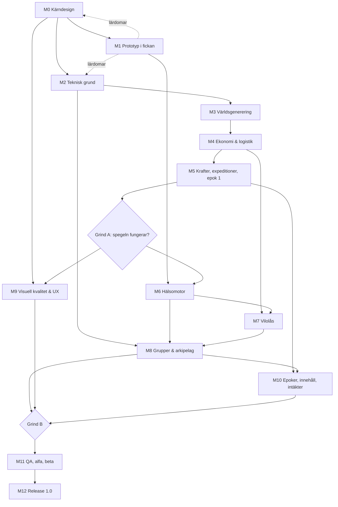

# EIRORA — Roadmap till version 1.0

> **Dokumentstatus:** Utkast v0.3 — reviderat efter produktgrillning och namnbeslut  
> **Datum:** 2026-10-17  
> **Produktkrav:** [PRD.md](./PRD.md) · **Ordlista:** [GLOSSARY.md](./GLOSSARY.md) · **Beslut:** [docs/adr/](./docs/adr/)  
> **Planeringsprincip:** kvalitetsstyrda milstolpar. **Utvecklingstid är aldrig en faktor** (D-09); genvägar och halvfärdiga system accepteras inte.

## 0. Hur roadmapen används

Roadmapen är en ordnad **beroendeplan**, inte en tidsplan.
Varje milstolpe har mål, leverabler, kvalitetsgrind och beroenden.

**Det som styr ordningen** är det som agenterna inte kan korta:

- **Kalendertid i riktiga dygn.**
  Om ett passivt spel med dygnsrytm är roligt syns bara genom att spela det dag efter dag.
  Därför kommer en spelbar prototyp på produktägarens telefon tidigt (M1), och den spelas parallellt med allt annat arbete.
- **Produktägarens tid** för beslut, granskning och test på fysiska enheter.
- **Butiksgranskningar och policyprocesser** (Health Connect-deklaration, App Review).

Arbetet sker via GitHub-ärenden i [Tiico/eirora](https://github.com/Tiico/eirora) enligt [docs/agents/](./docs/agents/).

### Statusar

`NOT_STARTED` → `IN_PROGRESS` → `IN_REVIEW` → `ACCEPTED`.
En milstolpe som inte klarar sin grind återgår till `IN_PROGRESS` med dokumenterade observationer.

### Övergripande grindar

| Grind | Omfattning | Vad den bevisar |
|---|---|---|
| **A — Spegeln fungerar** | M0–M5 | Egenvård → krafter → strategiska beslut är roligt i riktiga dygn, även med enbart manuell inmatning |
| **B — Tillsammans och i vardagen** | M6–M10 | Båda plattformarna, vilolås, grupper och arkipelag, vacker presentation, intäkter |
| **C — Förtjänar release** | M11–M12 | Balanserat, säkert, stabilt, policygodkänt och verifierat med riktiga användare |

---

## 1. Milstolpsöversikt

| Milstolpe | Namn | Huvudberoende | Status |
|---|---|---|---|
| M0 | Kärndesign | Beslut D-01–D-33 | IN_PROGRESS |
| M1 | Spelbar prototyp i fickan | M0 | NOT_STARTED |
| M2 | Teknisk grund | M0, lärdomar från M1 | IN_PROGRESS |
| M3 | Världsgenerering | M2 | NOT_STARTED |
| M4 | Ekonomi och logistik | M2, M3 | NOT_STARTED |
| M5 | Krafter, expeditioner, forskning och första epoken | M4, M1-lärdomar | NOT_STARTED |
| M6 | Hälsomotor och native-integrationer | M1-spike, M5 | NOT_STARTED |
| M7 | Vilolås och dygnscykel | M2, M4, M6 | NOT_STARTED |
| M8 | Grupper och gemensam arkipelag | M2 backend, M4, M6, M7 | NOT_STARTED |
| M9 | Visuell kvalitet, ljud och UX | Art direction från M0; full integration efter M5 | NOT_STARTED |
| M10 | Epoker, innehåll och intäkter | M5, M8 | NOT_STARTED |
| M11 | QA, balansering, alfa och beta | M0–M10 | NOT_STARTED |
| M12 | Release 1.0 | M11 | NOT_STARTED |

**Viktigt:** vilolåsets domäninvariant och krafternas regler skrivs in i simuleringskärnan redan i M1/M2, inte i efterhand.
Art direction pågår från M0 eftersom visuell skönhet är ett kvalitetskrav (D-29).

---

## 2. Detaljerade leveranser

### M0 — Kärndesign (kort)

**Mål:** spärra spelets kärna tillräckligt för att bygga en meningsfull prototyp.

1. Utöka [GLOSSARY.md](./GLOSSARY.md) med alla kärnbegrepp.
2. Simuleringsinvarianter: vad som alltid gäller för resurser, bybor, krafter, tid, vila, bidrag och kommandon.
3. Krafternas första regler: omvandling, tak, avtagande avkastning, manuell inmatning och neutral grundnivå.
4. Första ekonomin med siffror: 8–12 byggnader, 6–10 resurser, minst tre logistiska avvägningar, minst tre beslut om var krafterna ska riktas.
5. UX-resor: första sessionen, återkomst efter 7 dagar, kväll med vilolås.
6. Art direction: moodboard, palett och ljusstämningar för gryning, dag, skymning och natt i low-poly 3D, förankrade i det nordiska temat (PRD 1.3).
7. Kontur för epok 1.

**Artefakter:** GLOSSARY.md, `docs/design/` (invarianter, krafter, ekonomi v1, UX-resor, art direction), uppdaterad PRD, GitHub-ärenden för M1.

**Kvalitetsgrind A0:** det går att beskriva en hel dag inklusive vila, med konkreta siffror.
Inget beslut som blockerar prototypen är öppet.

### M1 — Spelbar prototyp i fickan

**Mål:** produktägaren spelar Eirora på sin Android-telefon varje dag så tidigt som möjligt.

1. Unity 6 LTS-projekt med motoroberoende C#-simuleringsbibliotek och tester i headless-läge.
2. En liten ö på hexkarta i low-poly 3D med enkelt dygnsljus.
3. En minimal ekonomi och de tre krafterna.
4. Steg och träning via Health Connect på riktig enhet, sömn där tillgängligt, samt manuell inmatning.
5. Lokalt vilolås med nattvy.
6. Daglig rapport.
7. Spike för Health Connect (verifiera `recordingMethod`, bakgrundsläsning, dubbletter); utvärdera HealthBridge mot egen adapter (O-08).
8. Bygg till iOS från Mac i CI för att bekräfta att kedjan fungerar, även utan iPhone.
9. Mät tidiga prestanda- och batterivärden på produktägarens telefon.

**Artefakter:** installerbar Android-prototyp, dagbok från dagligt spel, device-spike-rapport, lista över designlärdomar.

**Kvalitetsgrind A1:** produktägaren har spelat i minst 14 riktiga dygn.
Lärdomarna är dokumenterade och återförda till M0-designen.
Simuleringen är deterministisk i headless-tester.

### M2 — Teknisk grund

**Mål:** ett testbart, reproducerbart och uppgraderbart fundament.

1. Reporstruktur: Unity-klient, simuleringsbibliotek, ASP.NET Core-backend, delade kontrakt.
2. CI: tester, Android-bygge, iOS-bygge (macOS), kodanalys, beroendeskanning.
3. Simuleringskärna: `GameCommand`, `GameEvent`, idempotens, virtuell klocka, versionerade regler, snapshots, replay.
4. Sparformat med migrationsramverk och lokal persistens.
5. Backend-skelett: konto, auth, molnsparning, konfliktlösning mellan enheter (O-09).
6. Bevis att simuleringsbiblioteket körs identiskt på klient och server.
7. Mätbudgetar och lista över målenheter (O-13).
8. Varumärkes- och butikskontroll av "Eirora" (O-11).

**Kvalitetsgrind A2:** replay är deterministisk på klient och server.
En dubblett av ett kommando ändrar inte tillståndet två gånger.
En versionsuppgradering av ett sparat tillstånd fungerar.
Android- och iOS-byggen produceras i CI.

### M3 — Världsgenerering

1. Axiala hexkoordinater, grannar, area-sökning, höjd, gångbarhet, pathfinding.
2. `WorldGenerator`-gränssnitt och versionerat `WorldMap`-format.
3. Procedurgenererade ögrupper: hav, kust, farleder, berg, skog, odlingsmark, resurser.
4. Validator för startförutsättningar och expansionsvägar; bulkvalidering av tusentals seeds.
5. Dimma och upptäckt.
6. Förbered komposition av arkipelag (O-04) och `sourceType=GEOGRAPHIC` utan geodataimport.

**Kvalitetsgrind A3:** tusentals seeds valideras automatiskt.
Gamla världar laddas oförändrade.
Rendering och pathfinding fungerar på målenheter.

### M4 — Ekonomi och logistik

1. Byggplacering, bosättningar, uppgraderingar.
2. Recept, lager, arbetskraft, konsumtion, basbehov utan förfall.
3. Långsamma processer.
4. Vägar, hamnar, sjövägar inom världen, transportkapacitet, flaskhalsdiagnostik.
5. Konkurrerande investeringar och minst tre scenarier med olika optimala strategier.
6. Långtidssimulering av ekonomin, med och utan krafter.

**Kvalitetsgrind A4:** placering och logistik ger tydliga, begripliga effekter.
Långa frånvaroperioder bryter ingenting.
Minst två strategier fungerar och ingen dominerar.

### M5 — Krafter, expeditioner, forskning och första epoken

1. Fullständiga regler för Utforskning, Byggkraft och Gryningskraft med tak och avtagande avkastning.
2. Expeditioner som drivs av Utforskning: rutter, fynd, nya öar.
3. Forskning med minst tre inriktningar.
4. Guidad tur och löpande introduktion med tutorialelement.
5. Epok 1 från början till milstolpe.
6. Fake health provider för testscenarier: låg, hög, ingen och manuell egenvård.
7. Återkomst efter frånvaro (O-12).

**Kvalitetsgrind A5 / GRIND A:** en extern testare förstår hur egenvård blir krafter och krafter blir beslut, och spelar epok 1 med meningsfulla val. **Spelet är roligt även med enbart manuell inmatning**, och det är inte en stegräknare med dekor (R-01).

### M6 — Hälsomotor och native-integrationer

1. Health Connect: steg, träningspass, sömn, `recordingMethod`, bakgrund och historik.
2. HealthKit: motsvarande, inklusive `HKMetadataKeyWasUserEntered` och bakgrundsleverans. **iPhone anskaffas innan detta arbete påbörjas** (D-26).
3. Gemensamt C#-gränssnitt, normalisering, deduplicering, sen data, kompensationshändelser.
4. Klassning av verifierade och egenrapporterade bidrag.
5. Nekad, partiell och återkallad behörighet; radering.
6. Dataflödeskarta, DPIA-underlag, policykontroll för Play och App Store.

**Kvalitetsgrind B6:** båda plattformarna klarar behörighets- och importflöden på riktiga enheter.
Inga dubbla bidrag.
Rådata lämnar aldrig enheten.
Raderingen är verifierad.

### M7 — Vilolås och dygnscykel

1. Tillståndsmaskinen `ACTIVE → RESTING → DAWN → ACTIVE` i simuleringen.
2. Viloperiod 6–10 h, 24 timmars fördröjning vid ändring, IANA-tidszoner och sommartid.
3. Bybornas arbete pausar och långsamma processer fortgår.
4. Servern nekar gruppåtgärder under vila.
   Interaktioner som berör en vilande medlem köas.
5. Nattvy, gryningsövergång, tyst notisregim och morgonnotis.
6. Administrativa funktioner tillgängliga under vila.
7. Regler för resor och skiftarbete med användartest (O-07).

**Kvalitetsgrind B7:** inga spelpåverkande handlingar under vila via normala flöden.
Tidszon, sommartid, resor och skiftarbete är verifierade.
Nattläget upplevs lugnt i användartest.

### M8 — Grupper och gemensam arkipelag

1. Grupper om 2–6 via inbjudningslänk eller kod.
   Lämna, ta bort och blockera (O-05).
2. Komposition av arkipelag (O-04), sjövägar och handel mellan världar med validering på servern (O-10).
3. Gemensamma byggen med endast positiv koppling.
4. Delning av siffror per vana med samtycke, läget med enbart bockar per plattform, märkning av verifierat och egenrapporterat, tak för egenrapporterade bidrag.
5. Fördefinierade hälsningar och uppmuntran.
6. Säkerhetstest: IDOR, manipulerade bidrag, dubbla klick, replay.

**Kvalitetsgrind B8:** en grupp över Android och iOS bygger tillsammans utan dupliceringar eller läckor.
Ingen medlem påverkas negativt av en annans frånvaro.
Vilan respekteras.

### M9 — Visuell kvalitet, ljud och UX

1. Art bible: arkitektur, biomer, bybor, sjöfart, palett och ljus över hela dygnet.
2. Produktionsflöde för low-poly-assets, shaders, efterbehandling och ljussättning.
3. Terräng, byggnader i alla nivåer, bybor, skepp, expeditioner, nattmiljö, gryningsövergång.
4. Huvud-UI: krafter, rapport, byggkatalog, ekonomi, karta, forskning, grupp, butik.
5. Touchstyrning, kamera, ångra, felmeddelanden.
6. Musik, ambience för dag och natt, UI-ljud.
7. Lokalisering för engelska och svenska.
   Tillgänglighet.
8. Usabilitytest med nya spelare.

**Kvalitetsgrind B9:** visuell granskning godkänd.
Spelet är vackert på målenheterna inom prestandabudgeten.
Kritiska handlingar går att hitta utan instruktion.

### M10 — Epoker, innehåll och intäkter

1. Epoker för release (O-03), med verktyg för att producera nya epoker efter release.
2. Balansgranskade byggnader, resurser, kedjor, forskningsgrenar och fynd (O-02).
3. Historik för världen och arkipelagen.
4. Innehållsvalidatorer i CI.
5. Kosmetika, supporter-prenumeration (O-06), serverbaserad köpvalidering, inga reklam-SDK:er.

**Kvalitetsgrind B10 / GRIND B:** hela spelet fungerar på båda plattformarna, i grupp och över kontobyte.
Inget innehåll låser fast spelaren.
Intäktsmodellen bryter inte mot MON-04.

### M11 — QA, balansering, alfa och beta

1. Komplett testmatris för domän, integration, mobil, backend, tidszoner och behörigheter.
2. Massimulering över år av speltid med låg, hög, ingen och manuell egenvård.
3. Property-based-test av invarianter, idempotens och tid.
4. Belastningstest av backend, reconnect och handel.
5. Profilering av batteri, minne, fps och starttid.
6. Sluten alfa med djupintervjuer.
7. Beta i 30–60 dagar med grupper av vänner med olika rutiner och datakällor.
8. Mätning av motivation och negativa effekter: stress, grupptryck, förskjuten läggtid.
9. Frys nytt innehåll inför releasekandidaten.

**Kvalitetsgrind C11:** inga blockerande eller allvarliga fel.
Kvalitetsmålen är uppfyllda.
Testerna stödjer tesen om ett roligt och hälsosamt spel.

### M12 — Release 1.0

1. Varumärke, butikssidor, skärmbilder, trailer, supportmaterial.
2. Deklarationer för Health Connect och HealthKit, integritetsetiketter, dataskydd.
3. Oberoende säkerhetsgranskning av hälsodata och gruppflöden.
4. Katastrofåterställning, migrationstest, rollbackplan.
5. Stegvis utrullning på båda plattformarna samtidigt.
6. Underhållsplan och backlog för 1.1 (nya epoker) och V2 (geografiska kartor).

**Kvalitetsgrind C12 / RELEASE:** alla P0-krav och godkända P1-krav är verifierade, butikskraven uppfyllda och rollback och restore testade.

---

## 3. Parallella arbetsströmmar

| Ström | Start | Fokus |
|---|---|---|
| Speldesign/balans | M0 | Krafter, ekonomi, epoker, grupper |
| Dagligt prototypspel | M1 | Produktägaren spelar och dokumenterar, kontinuerligt fram till beta |
| Simulering/backend | M1 | Delad C#-simulering, ASP.NET Core, beständighet |
| Klient/UX | M1 | Unity, kamera, UI, rapporter |
| Art/ljud | M0 | Art direction, ljus, assets, musik |
| Hälsa/OS | M1-spike | Health Connect, HealthKit, integritet |
| Drift/QA/privacy | M2 | CI, observability, DPIA, policy |

---

## 4. Beroendekarta

---

## 5. Epics och första backlog

| Epic | Milstolpe | Beskrivning | PRD-ID |
|---|---|---|---|
| EP-01 | M0 | Kärndesign, invarianter, krafter, ekonomi | CIV-*, EXP-*, HLT-09 |
| EP-02 | M1 | Spelbar prototyp i fickan | Tvärs |
| EP-03 | M2 | Simuleringskärna, sparformat, CI, backend-skelett | NFR-01/02/09/11, ACC-* |
| EP-04 | M3 | Kartdata, generator, hexgeometri | MAP-* |
| EP-05 | M4 | Bygg, produktion, logistik | CIV-*, LOG-01…04/06 |
| EP-06 | M5 | Krafter, expeditioner, forskning, onboarding, epok 1 | HLT-05/09, EXP-*, RES-*, PRG-* |
| EP-07 | M6 | Health Connect, HealthKit, bidrag, integritet | HLT-* |
| EP-08 | M7 | Vilolås och dygnscykel | RST-* |
| EP-09 | M8 | Grupper, arkipelag, handel, gemensamma byggen | SOC-*, LOG-05, MAP-07 |
| EP-10 | M9 | Art, ljud, UX, lokalisering, tillgänglighet | UX-*, NFR-13 |
| EP-11 | M10 | Epoker, innehåll, intäkter | PRG-03/05, NAR-01, MON-* |
| EP-12 | M2–M12 | Drift, säkerhet, integritet, test | OPS-*, NFR-* |

### Första uppgifterna

1. **TASK-001 — Kärnfantasi:** 1–2 sidor om varför "din värld speglar din egenvård" blir ett bra strategispel och inte en stegräknare.
2. **TASK-002 — Simuleringsinvarianter.**
3. **TASK-003 — Krafternas regler v1:** omvandling, tak, avtagande avkastning, manuell inmatning, grundnivå.
4. **TASK-004 — Ekonomi v1 med siffror:** byggnader, resurser, avvägningar och kraftbeslut.
5. **TASK-005 — UX-resor:** första sessionen, sju dagars frånvaro, kväll med vilolås.
6. **TASK-006 — Art direction v0:** moodboard, palett, ljus över dygnet.
7. **TASK-007 — Spike för Health Connect** på produktägarens telefon; HealthBridge eller egen adapter (O-08).
8. **TASK-008 — Unity-prototyp:** ö, ekonomi, krafter, vilolås, rapport.
9. **TASK-009 — Format för prototypdagbok** och rutin för att återföra lärdomar.
10. **TASK-010 — Reporstruktur och CI** för Android och iOS.

**Format för backlogpost:** ett GitHub-ärende med Epic, Milstolpe, PRD-referens, Prioritet, Förutsättningar, Beskrivning, Invariant, Acceptanskriterier (Given/When/Then), Testnivå, Integritetspåverkan, Migration och Definition of Done.

---

## 6. Arkitekturbeslut

| ADR | Beslut | Status |
|---|---|---|
| [ADR-0001](./docs/adr/0001-local-world-server-for-shared-state.md) | Den egna världen simuleras lokalt; servern äger det delade | Beslutat |
| [ADR-0002](./docs/adr/0002-unity-csharp-shared-simulation.md) | Unity 6 LTS + C#, delad simulering, ASP.NET Core | Beslutat |
| [ADR-0003](./docs/adr/0003-rest-lock-is-honest-protection.md) | Vilolåset är ett ärligt skydd, inte fuskskydd | Beslutat |
| [ADR-0004](./docs/adr/0004-simulation-as-local-unity-package.md) | Simuleringen delas med Unity som lokalt paket i källkodsform | Beslutat |
| kommande | Tidsmotor, tidszoner och dygnsschema | Inför M2/M7 |
| kommande | Kartformat och generatorversion | Inför M3 |
| kommande | Versionering av regler, innehåll och sparningar | Inför M2 |
| kommande | Hälsoadapter: HealthBridge eller egen (O-08) | Inför M1/M6 |
| kommande | Backend-hosting, auth och databas (O-09) | Inför M2 |
| kommande | Komposition av arkipelag och handelsvalidering (O-04, O-10) | Inför M8 |

---

## 7. Teststrategi

| Testtyp | Start | Verifierar |
|---|---|---|
| Unit + property-based | M1 | Resurskonservering, krafter, idempotens |
| Deterministisk replay, klient = server | M2 | Samma indata ger samma tillstånd |
| Generatorfuzzning | M3 | Rimliga kartor, startresurser |
| Långtidssimulering | M4 | Ekonomi och vila vid lång frånvaro, ingen förfall |
| Balansbotar | M4/M5 | Dominerande strategier, kraftfördelning |
| Native-hälsa på enhet | M1/M6 | Behörigheter, metadata, bakgrund, dubbletter |
| Tid, tidszon och sommartid | M2/M7 | Vilolåsets invariant |
| Säkerhet och flera konton | M8 | Gruppbidrag, handel, IDOR, replay |
| Visuell granskning och prestanda | M1/M9 | Skönhet inom budget på målenheter |
| UI och tillgänglighet | M9 | Touch, läsbarhet, språk |
| Longitudinell beta | M11 | Motivation, grupptryck, sömnrytm |
| Restore och rollback | M2/M12 | Migration och återställning |

### Definition of Done

- Länkat till PRD-krav och acceptanstest.
- Domänregler och gränsfall dokumenterade, med ordlistans termer.
- Inga Unity-beroenden i simuleringsbiblioteket.
- Testat på relevant nivå, inklusive determinism och idempotens där det gäller.
- Migrationspåverkan analyserad.
- Integritet och observability granskade.
- Användarflödet manuellt verifierat på enhet.

---

## 8. Releasechecklista

- [ ] Alla P0-krav verifierade på Android och iOS.
- [ ] Godkända P1-krav levererade; ändringar dokumenterade.
- [ ] Spelet är fullt spelbart med enbart manuell inmatning.
- [ ] Vilolåset håller via normala flöden, med rimliga regler för skift, resor och sommartid.
- [ ] Inga dubbla bidrag.
      Rådata lämnar aldrig enheten.
- [ ] Gruppspel fungerar mellan plattformarna utan negativ koppling.
- [ ] Delning av siffror sker endast med samtycke per vana.
      Läget med enbart bockar är testat.
- [ ] Offline, reconnect, flera enheter, kontobyte och migrering testade.
- [ ] Visuell kvalitetsgrind godkänd inom prestandabudget.
- [ ] Säkerhets- och dataskyddsgranskning genomförd.
- [ ] Health Connect-deklaration och App Review-krav uppfyllda.
- [ ] En beta i 30–60 dagar stödjer långsiktig motivation utan negativ stress.
- [ ] Drift, rollback, incidenthantering, backup och support fungerar.

---

## 9. Efter 1.0

**1.x:** nya epoker, fler kosmetika, fler expeditionskedjor, fler språk, fler vanor (HLT-13).

**V2:** världar genererade från verklig geografi (D-05), givet att samma `WorldMap`-kontrakt används och att licens-, integritets- och balansfrågor är lösta.

Ingen feature får användas som ursäkt för att skjuta grundläggande arkitektur- eller integritetsproblem till senare.

---

## 10. Överlämningsprompt till nästa agent

> Du arbetar på Eirora: *A world worth growing.*
> Läs PRD.md, ROADMAP.md, GLOSSARY.md och docs/adr/ som källor till sanning, och AGENTS.md för arbetsflödet.
> Respektera allt som är markerat [BESLUTAT].
> Utvecklingstid är aldrig en faktor; välj alltid den bästa lösningen.
> Kärnan: egenvård (steg, träning, sömn) blir tre krafter som spelaren strategiskt riktar i en ögrupp på en hexkarta i vacker low-poly 3D med nordiskt mytologiskt tema; inget slut, epoker; grupper om 2–6 delar en arkipelag med endast positiv koppling; vilolås 6–10 h.
> Börja med M0 (TASK-001–006) och förbered M1 så att produktägaren kan spela dagligen på sin Android så snart som möjligt.
> Skapa GitHub-ärenden enligt docs/agents/.

---

## 11. Ändringshistorik

| Version | Datum | Ändring |
|---|---|---|
| 0.1 | 2026-10-17 | Första planutkast M0–M11 (Arkipelagen). |
| 0.2 | 2026-10-17 | Verdawn. Ny ordning med tidig prototyp i fickan (M1). Hälsa, vilolås, grupper och arkipelag som kärna. Unity + ASP.NET Core. Visuell kvalitet som egen ström och grind. M0–M12. |
| 0.3 | 2026-10-17 | Namn Eirora ersätter Verdawn; art direction förankras i det nordiska temat. |
