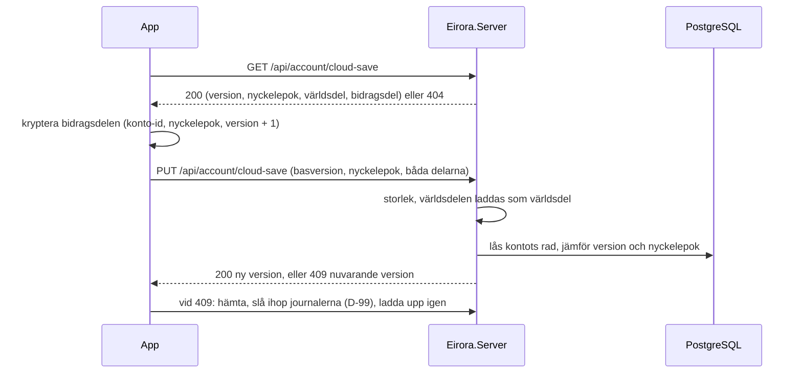

# Hotmodell: molnsparning

> **Ärende:** TASK-023 (#38) · **PRD:** ACC-01, ACC-03, ACC-05, HLT-10, NFR-10 · **Beslut:** [ADR-0008](../adr/0008-backend-hosting-accounts-and-database.md), [ADR-0001](../adr/0001-local-world-server-for-shared-state.md), D-57, D-99–D-101

Hotmodellen gäller hur `Eirora.Server` lagrar och lämnar ut kontots molnsparning: världsdelen, den krypterade bidragsdelen och låsta bidragsdelar från tidigare nyckelepoker.
Krypteringen på enheten och sammanslagningen av journaler (TASK-023 del 3) står i raderna om enheten nedan, liksom nyckelöverföringen mellan två telefoner via servern och återställningskoden (TASK-023b, #108, del 1); den tysta synken via plattformens nyckelring fyller i sina rader när den byggs.
Inloggningen och kontot har en egen hotmodell, [sign-in-threat-model.md](./sign-in-threat-model.md), och allt här förutsätter den.

## Det som skyddas

- **Bidragsdelen:** egenvården per dag, de använda idempotensnycklarna och journalerna (D-100).
  Den är personuppgifter av särskild kategori, och servern ser den bara som chiffertext.
- **Världsdelen:** kartan och senaste snapshoten utom det som hålls per dag.
  Den hör till ett känt konto men avslöjar inget om egenvården.
- **Spelarens värld:** att bara spelarens egna enheter ersätter molnsparningen, och att två av dem inte skriver över varandras spel (ACC-03).
- **Servern:** att en uppladdning inte kan fälla den eller fylla dess minne.

## Flödet

| Anrop | Svar |
|---|---|
| `GET /api/account/cloud-save` | 200 `CloudSave`, 404 när kontot inte har någon |
| `PUT /api/account/cloud-save` | 200 `CloudSaveVersion`; 409 `CloudSaveVersion` med den nuvarande; 400 när formatet är fel; 413 över gränserna |
| `GET /api/account/cloud-save/locked` | 200 med kontots låsta bidragsdelar |
| `DELETE /api/account/cloud-save/locked/{keyEpoch}` | 204, eller 404 när kontot inte har någon sådan |
| `POST /api/account/key-transfers` | 201 `KeyTransfer` med den nya telefonens engångsnyckel; 400 när nyckeln inte är 32 byte |
| `GET /api/account/key-transfers/{id}` | 200 `KeyTransfer`, med den förseglade nyckeln en gång; 404 när den gått ut, tagits eller ersatts |
| `PUT /api/account/key-transfers/{id}` | 204; 409 när en nyckel redan levererats; 404; 400 över 1 KiB |
| `DELETE /api/account/key-transfers/{id}` | 204, 404 |

## Gränser

- **Världsdelen** får vara högst 1 MiB (`CloudSaveUpload.MaxWorldBytes`).
  Den är kartan och en snapshot, ungefär 8 KiB på prototypens karta med radie 24, så gränsen rymmer kartor hundra gånger större.
- **Bidragsdelen** får vara högst 8 MiB (`CloudSaveUpload.MaxContributionBytes`).
  Den växer med journalen, med långt under 1 KiB per spelat dygn, tills en ny regelversion börjar ett nytt segment; 8 MiB räcker för mer än tio års spel med båda segmenten kvar.
- **Hela begäran** får vara högst delarnas gränser i base64 och 64 KiB till, ungefär 12 MiB; Kestrel avbryter en större begäran redan medan den läses.
- **En molnsparning per konto**, som varje uppladdning ersätter, och en låst bidragsdel per tidigare nyckelepok i högst 90 dagar.
- **En nyckelöverföring per konto**, som en ny ersätter, med en förseglad nyckel på högst 1 KiB, i högst tio minuter och lämnad ut en gång.

## Hot och skydd

| Hot (STRIDE) | Exempel | Skydd | Test |
|---|---|---|---|
| Behörighet (IDOR) | En spelare läser eller ersätter någon annans molnsparning | Ingen route tar ett konto-id; molnsparningen är alltid tokenens `sub`, som i resten av `/api/account` | `AnotherPlayersTokenOnlyEverReachesThatPlayersOwnCloudSave`, `WithoutAValidTokenTheCloudSaveIsNotReached` |
| Informationsläckage | Databasen läcker, eller en administratör läser bidragen | Bidragsdelen krypteras på enheten och lagras som exakt de byte som laddades upp; servern har ingen nyckel och dekrypterar aldrig | `TheContributionPartIsStoredAsTheBytesThatWereUploaded` |
| Informationsläckage | En klient lägger egenvård per dag i världsdelen | Världsdelen måste laddas som en världsdel: bara kartan och snapshoten, och en snapshot som skrivs tillbaka till exakt samma text, så att ingen extra rad följer med | `AnUploadWhoseWorldPartDoesNotLoadIsRejectedAndNothingIsStored` |
| Informationsläckage | Molnsparningens innehåll hamnar i loggar | Uppladdningar loggas inte; bara att en bidragsdel låstes, utan värden | `LogsNeverContainTokensNoncesOrIdentifiers` |
| Manipulering | Två enheter som spelat offline skriver över varandras spel | Uppladdningen anger vilken version den bygger på, kontots rad är låst medan versionen jämförs och skrivs, och en annan bas ger 409 med den nuvarande versionen, så att klienten slår ihop journalerna (D-99) | `AnUploadBasedOnAnotherVersionConflictsAndSaysWhichIsCurrent`, `OfUploadsAtOnceFromTheSameVersionOnlyOneIsStored` |
| Manipulering | En ny telefon skriver över kontots molnsparning med en ny värld vid första inloggningen | Basversion 0 godtas bara när kontot saknar molnsparning | `AnUploadBasedOnAnotherVersionConflictsAndSaysWhichIsCurrent` (0) |
| Manipulering | En enhet med en gammal nyckel ersätter en bidragsdel från en nyare nyckelepok | Nyckelepoken sjunker aldrig; en äldre epok ger 409 | `AnUploadOfAnOlderKeyEpochConflicts` |
| Manipulering | En ny nyckelepok raderar bidragen från den förra | Den ersatta bidragsdelen låses och sparas i 90 dagar om nyckeln skulle dyka upp (ADR-0008) | `ANewKeyEpochLocksTheContributionPartItReplaces`, `TheSameKeyEpochLocksNothing` |
| Manipulering | Servern, eller den som når databasen, byter bidragsdelar mellan spelare eller versioner | Bidragsdelens associerade data är konto-id, nyckelepok och den version uppladdningen blir (basversionen + 1), som servern sätter exakt så; enheten upptäcker en utbytt del och slår aldrig ihop den | `ContributionCipherTests.APartSealedForAnotherAccountEpochOrVersionDoesNotOpen`, `CloudSyncTests.APartMovedToAnotherVersionDoesNotOpen` |
| Manipulering | En stulen token, eller den som når databasen, ersätter bidragsdelen eller hela molnsparningen | Utan nyckeln går ingen bidragsdel att försegla; en del som inte öppnas med telefonens nyckel för dess epok slås aldrig ihop, utan spelaren väljer (D-102), och behåller spelaren telefonens ö låses den utbytta delen under en ny nyckelepok | `CloudSyncTests.AContributionPartThatDoesNotOpenIsNeverMergedAndThePlayerChooses`, `Eirora.Server.Tests.CloudSyncTests.AContributionPartChangedInTheDatabaseIsNeverMerged`, `ContributionCipherTests.AChangedByteAnywhereIsNoticed` |
| Manipulering | Två enheter som spelat offline skriver över varandras spel (enhetens sida) | En uppladdning som bygger på en annan version får 409, enheten hämtar molnsparningen, slår ihop journalerna från den gemensamma segmentstarten (D-99) och laddar upp igen; sammanslagningen är idempotent och ger samma resultat från båda hållen | `SaveMergeTests`, `CloudSyncTests.TwoPhonesThatPlayedApartMergeTheirJournals`, `Eirora.Server.Tests.CloudSyncTests.TwoPhonesThatPlayedOfflineMergeWithoutDoubleContributionsOrBuildings` |
| Informationsläckage | Bidragsnyckeln lämnar enheten eller hamnar i loggar | Nyckeln skapas av plattformens kryptografiska slump, ligger i plattformens keystore under kontots id, används bara i chiffret och loggas aldrig; den lämnar enheten först i TASK-023b, och bara krypterad | `DeviceCloudSyncStorageTests.TheKeyLivesInTheKeystoreUnderTheAccount`, `ContributionCipherTests.TwoGeneratedKeysDiffer` |
| Informationsläckage | Samma nonce två gånger under samma nyckel | Varje försegling drar en ny slumpad nonce på 192 bitar, vilket är varför XChaCha20 och inte ChaCha20 | `ContributionCipherTests.EverySealGetsItsOwnNonceAndCiphertext` |
| Informationsläckage | Servern, eller den som når databasen, läser bidragsnyckeln ur en nyckelöverföring | Den gamla telefonen förseglar nyckeln för den nya telefonens X25519-engångsnyckel, vars privata halva aldrig lämnar den nya telefonen; servern lagrar bara den publika nyckeln och chiffertexten, i högst tio minuter, och lämnar ut chiffertexten en gång | `KeyTransferTests.TheServerStoresOnlyWhatItCannotRead`, `TheOldPhoneDeliversTheSealedKeyAndTheNewPhoneTakesItOnce`, `KeyTransferCipherTests.AnotherPhoneAccountOrTransferDoesNotOpenIt` |
| Manipulering | Servern, eller den som har kontots token, planterar en egen bidragsnyckel på den nya telefonen genom att försegla den för den publika nyckel servern lagrar, och läser sedan allt som förseglas med den | Biljetten bär en hemlighet på 128 bitar som bara går från den nya telefonen till den gamla, i QR-koden, aldrig till servern; den blandas in i nyckelhärledningen, så bara den som läst biljetten kan försegla en nyckel som öppnas. Dessutom behålls en nyckel utifrån bara när molnsparningen bekräftar den: epoken är molnsparningens och bidragsdelen öppnas med den | `KeyTransferCipherTests.WithoutTheTicketsSecretNoOneCanSealAKeyThePhoneOpens`, `KeyTransferTests.TheRelayCannotPlantAKeyOnTheNewPhone` (Eirora.CloudSaving.Tests), `Eirora.Server.Tests.KeyTransferTests.TheServerStoresOnlyWhatItCannotRead`, `CloudSyncTests.AKeyFromOutsideIsKeptOnlyWhenTheCloudSaveConfirmsIt` |
| Manipulering | En gammal återställningskod, eller en nyckel från en gammal telefon, ersätter den nyckel telefonen har och fortfarande behöver | En nyckel utifrån behålls bara när den är molnsparningens: en äldre epok avvisas med besked, liksom en nyckel som inte öppnar bidragsdelen | `CloudSyncTests.AKeyFromOutsideIsKeptOnlyWhenTheCloudSaveConfirmsIt`, `KeyTransferTests.AKeyOfAnOlderEpochIsNotKept`, `CloudSaveSyncTests.AStaleRecoveryCodeIsRefusedAndTheKeyThePhoneHoldsStays` |
| Behörighet (IDOR) | Någon annan läser, levererar till eller avbryter kontots överföring | Ingen route tar ett konto-id; en överföring nås bara med en token för kontot den skapades för, och ett ovanligt id är slumpat med 128 bitar | `KeyTransferTests.AnotherPlayersTokenNeverReachesTheTransfer`, `WithoutAValidTokenNoTransferIsReached` |
| Manipulering | Någon som ser biljetten (QR-koden) och har kontots token levererar en egen nyckel, eller flyttar en förseglad nyckel till en annan överföring | Den som läst biljetten har hemligheten och kan försegla en nyckel som öppnas; den behålls ändå bara när molnsparningen bekräftar den. En förseglad nyckel är bunden till kontot och överföringen, så den öppnas inte i en annan. En nyckel som inte öppnas avslutar överföringen, så en ny biljett behövs | `KeyTransferTests.AKeySealedForAnotherPhoneIsNotKept`, `AKeyOfAnOlderEpochIsNotKept` (Eirora.CloudSaving.Tests), `KeyTransferCipherTests.AChangedByteAnywhereIsNoticed` |
| Manipulering | Den gamla telefonen skannar en QR-kod som inte är en biljett, eller en biljett som gått ut eller redan använts | Bara en hel biljett (`KeyTransferTicket.TryParse`) skickas något för; en annan kod ger ett besked och skanningen fortsätter. Servern svarar 404 på en biljett den glömt och 409 på en som redan fått sin nyckel, och telefonen säger det | `AccountSheetTests.TheNewPhoneShowsACodeAndTheOldPhoneScansItToSendTheKey`, `CloudSaveSyncTests.ARunOutTicketIsSeenOnBothPhonesAndANewOneCanBeShown`, `CloudSaveSyncTests.TheOldPhoneSendsTheKeyToTheNewOneThroughTheTicketItShows` (EditMode) |
| Manipulering | Servern, eller den som har kontots token, skapar en egen överföring och får sin QR-kod framför den gamla telefonens kamera (en utskrift, en skärm, en telefon bredvid den riktiga), så att bidragsnyckeln skickas till den | Nyckeln skickas först när spelaren bekräftat, med kameran avstängd, och båda telefonerna visar en kontrollkod på sex siffror ur biljetten (SHA-256 över id, publik nyckel och hemlighet) att jämföra innan den skickas; en främmande kod ger med all sannolikhet en annan kontrollkod, och en biljett tolkas strikt så att en krafsad kod aldrig kastar | `AccountSheetTests.TheNewPhoneShowsACodeAndTheOldPhoneScansItToSendTheKey`, `AccountSheetTests.GoingBackFromTheCodeGivesTheTicketUpAndClosingTheSheetStopsTheCamera` (EditMode), `KeyTransferCipherTests.ACraftedTicketIsNotOneAndNeverThrows`, `KeyTransferCipherTests.TheCheckCodeIsSixDigitsFromTheWholeTicketAndTheSameOnBothPhones` |
| Manipulering | Två leveranser eller två hämtningar i samma ögonblick | Leveransen är en villkorad uppdatering och hämtningen en villkorad radering i samma sats som kontrollen, så en nyckel lagras en gång och lämnas ut en gång | `KeyTransferTests.DeliveriesAndTakesAtOnceStillHappenOnce` |
| Manipulering | En ny telefon börjar en ny nyckelepok innan nyckeln fått en chans att komma fram | Telefonen frågar först efter nyckeln, från den gamla telefonen eller som återställningskod, och börjar en ny epok bara när spelaren väljer att fortsätta utan | `CloudSyncTests.ANewPhoneWithoutTheKeyIsAskedForItBeforeANewEpochBegins`, `Eirora.Server.Tests.CloudSyncTests.TheOldPhoneSendsTheKeyToTheNewPhoneThroughTheServerAndNoEpochBegins` |
| Informationsläckage | Återställningskoden skrivs fel eller läses av någon annan | Koden bär en kontrollsumma, så ett feltecken avvisas i stället för att ge fel nyckel; den visas bara på begäran i kontovyn med en varning om att den som har koden kan läsa egenvården, och lämnar aldrig telefonen genom spelet | `RecoveryCodeTests.AWrongCharacterIsCaught`, `AccountSheetTests.TheRecoveryCodeIsShownOnRequestOnly` |
| Kvarvarande data | En överföring lever kvar på servern | Den raderas när den lämnas ut, när en ny skapas, när kontot raderas, och gallras efter tio minuter | `KeyTransferTests.ATransferRunsOutAfterTenMinutesAndIsPruned`, `ANewTransferReplacesTheAccountsPendingOne`, `DeletionTests.ADeletedAccountLeavesNoAccountDataOnTheServer` |
| Kvarvarande data | Bidragsnyckeln lever kvar på enheten efter att kontot raderats | Enheten glömmer nyckeln och molnsparningens version när raderingen bekräftats | `CloudSaveSyncTests.SigningOutTurnsTheCloudSaveOffAndDeletingTheAccountForgetsTheKey` |
| Förnekande av tjänst | Stora uppladdningar fyller minnet, disken eller WAL-arkivet | Gränser per del och för hela begäran, och en molnsparning per konto | `AnUploadOverItsLimitsIsRejectedAsTooLarge`, `AContributionPartAtItsLimitIsStored` |
| Förnekande av tjänst | En liten men tillverkad världsdel med rätt hash får servern att allokera en enorm karta | Kartläsaren avvisar en radie som texten inte rymmer innan några rutor allokeras; godtyckliga ändringar i en världsdel ger bara 400 | `ARadiusTheTextCannotHoldIsRejectedBeforeAnyTileIsAllocated`, `ACraftedWorldPartIsRejectedOrAcceptedButNeverBreaksTheServer` |
| Upphöjning | En tillverkad världsdel får servern att köra spelets logik | Servern laddar världsdelen bara för att kontrollera formatet och kastar resultatet; den simulerar aldrig den egna världen (ADR-0001) | – |
| Kvarvarande data | Molnsparningen lever kvar efter att kontot raderats | Molnsparningen och de låsta bidragsdelarna raderas med kontots rad (främmande nycklar med kaskad) | `ADeletedAccountLeavesNoAccountDataOnTheServer` |
| Kvarvarande data | En låst bidragsdel sparas för länge | Den raderas efter 90 dagar, eller tidigare om spelaren väljer det | `ALockedContributionPartIsDeletedAfterNinetyDays`, `APlayerCanDeleteALockedContributionPartEarly` |

## Accepterade risker

- **En stulen access-token kan ersätta molnsparningen** inom sina 15 minuter, utan färsk inloggning, eftersom uppladdningar sker i bakgrunden.
  Tjuven kan inte läsa bidragen och inte tillverka en bidragsdel som går att dekryptera, men kan byta ut världsdelen.
  Telefonen har kvar sin värld, och slår aldrig ihop en molnsparning vars bidragsdel inte öppnas med nyckeln: spelaren väljer, och den utbytta delen låses under en ny nyckelepok (D-102).
- **Världsdelen är inte krypterad.** Den visar kartan, byn, krafternas saldon, dimman och klockan för ett känt konto, men inget per dag (D-100).
- **Metadata syns för servern:** när molnsparningen senast laddades upp, hur många gånger och hur stor bidragsdelen är, och därmed ungefär hur mycket spelaren spelar.
- **En app som är nyare än servern** kan inte ladda upp en världsdel som servern inte kan läsa (400) förrän servern uppdaterats; servern driftsätts därför före appen.
- **Kestrels gräns för hela begäran** prövas inte av integrationstesterna, eftersom testservern inte begränsar storleken; gränserna per del gör det.
- **Sammanslagningen spelar upp hela journalen på enheten,** så en mycket lång journal märks som en paus när två enheter stämmer av; journalen börjar om vid varje regelversion, och tiden mäts i TASK-024.
- **Nyckeln ligger i enhetens keystore utan eget skärmlåskrav,** som refresh-token; en upplåst telefon i fel händer läser bidragen, som den läser spelet.

- **Metadata om överföringen syns för servern:** att en överföring skapades och när nyckeln levererades, vilket säger att spelaren bytte telefon.
- **Biljetten (QR-koden) är hemlig i tio minuter:** den som ser den och dessutom har kontots token kan leverera en nyckel som öppnas, men den behålls bara om den är molnsparningens, och överföringen är över efter en leverans. Spelaren visar QR-koden bara för sin gamla telefon.
- **Kontrollkoden kräver att spelaren jämför:** en spelare som trycker Skicka utan att titta på den nya telefonen skickar nyckeln till den som visade koden; frågan och koden gör angreppet synligt, inte omöjligt.
- **Kontrollkoden har en miljon värden:** den som både kan skapa en överföring för kontot och ser den nya telefonens kontrollkod kan på under en sekund ta fram en egen biljett med samma kod (behåll serverns id, dra nya hemligheter tills SHA-256 träffar), och en slumpmässig främmande biljett träffar med sannolikheten en på miljonen. Att se skärmen kräver att vara i rummet eller ha en inspelning, så kombinationen är smal och accepteras.
- **QR-koden står på skärmen tills spelaren lämnar den:** den som ser den nya telefonens skärm kan fotografera biljetten; den är ändå värdelös utan kontots token, och koden försvinner så fort nyckeln kommit, biljetten gått ut eller spelaren tryckt Avbryt, då servern också glömmer den.
- **Kameran:** den gamla telefonen öppnar bakkameran bara medan skannerarket är öppet och stänger den när arket byts eller stängs; bilderna läses på telefonen (ZXing.Net) och lämnar den aldrig. Android frågar om tillstånd vid första användning, iOS med texten i spelarinställningarna; nekas det får spelaren rådet att skriva in återställningskoden på den nya telefonen i stället.
- **Tangentbordets ordlista:** fältet för återställningskoden stänger av autokorrigering och töms när koden prövats, men ett tangentbord från tredje part kan ändå minnas det som skrivs.

## Kvar till kommande ärenden

- Den tysta synken via iCloud-nyckelringen och Block Store, och att nyckeln tas bort ur nyckelringen när kontot raderas (TASK-023b, #108, del 3).
