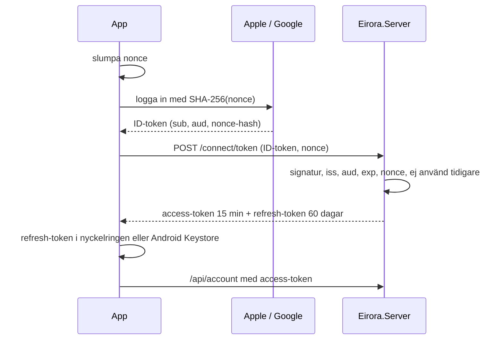

# Hotmodell: konto och inloggning

> **Ärende:** TASK-022 · **PRD:** ACC-01, ACC-04, ACC-05, NFR-05, NFR-06, NFR-10 · **Beslut:** [ADR-0008](../adr/0008-backend-hosting-accounts-and-database.md), D-72

Hotmodellen gäller kontot och inloggningen i `Eirora.Server` och klienten: hur ett konto skapas, nås, kopplas och raderas, i appen och på raderingssidan.
Molnsparningen och de krypterade bidragen (TASK-023) får en egen genomgång.

## Det som skyddas

- **Kontot:** att bara spelaren själv når sitt konto och sin kommande molnsparning.
- **Kopplingen mellan konto och person:** leverantörernas `sub` för Apple och Google.
  Servern lagrar inget namn och ingen e-post (D-72).
- **Tillgängligheten** för inloggning och radering.

Den egna världen påverkas aldrig: den kräver inget konto och fungerar offline även när servern är nere (ACC-04).

## Flödet

På Android går Sign in with Apple som webbflöde: Apple postar svaret till serverns `/signin/apple/callback`, som lämnar det till appen som en `intent:`-adress med appens paketnamn.
På raderingssidan loggar spelaren in med Apple eller Google i webbläsaren på samma sätt, med en nonce som sidan slumpar.

## Hot och skydd

| Hot (STRIDE) | Exempel | Skydd | Test |
|---|---|---|---|
| Förfalskning | Någon tillverkar en ID-token för en annan spelare | Signaturen kontrolleras mot leverantörens nycklar från dess discovery-dokument, liksom `iss`, `aud` (appens egna klient-id) och `exp` | `ATokenTheProviderDidNotIssueToTheAppIsRejected` |
| Förfalskning | En ID-token som utfärdats till en annan app används mot oss | `aud` måste vara ett av appens klient-id | samma (wrong audience) |
| Återspelning | En uppsnappad ID-token skickas igen | Varje ID-token accepteras en gång (hash sparas till `exp`), och bara tillsammans med den nonce vars hash den bär | `AnInterceptedIdTokenCannotBeUsedASecondTime`, `ATokenIsOnlyAcceptedWithTheNonceItWasRequestedWith` |
| Behörighet (IDOR) | En spelare når någon annans konto med sin token | Ingen route tar ett konto-id; kontot är alltid tokenens `sub` | `AnotherPlayersTokenOnlyEverReachesThatPlayersOwnAccount` |
| Kontoövertagande | En stulen refresh-token används | Refresh-token roteras vid varje användning, och en återanvänd token spärrar kedjan; utloggning återkallar den | `RefreshingGivesNewTokensForTheSameAccount`, `SigningOutRevokesTheRefreshToken` |
| Kontoövertagande | Någon med en stulen access- eller refresh-token kopplar in sin egen inloggning, kopplar bort spelarens eller raderar kontot | Koppling, bortkoppling och radering kräver var och en en färsk inloggning med en av kontots egna inloggningar; en token räcker aldrig. Svagt skydd mot en upplåst telefon, se accepterade risker | `LinkingRequiresAFreshSignInWithALoginOfTheAccount`, `AStolenRefreshTokenCannotRemoveTheOwnersLogins`, `DeletionIsConfirmedWithALoginOfThisAccount` |
| Kontoövertagande | Någon kopplar in en inloggning som tillhör ett annat konto och slår ihop dem | Konton slås aldrig ihop; en inloggning tillhör högst ett konto | `ALoginOfAnotherAccountCannotBeLinked` |
| Informationsläckage | Token, nonce eller identifierare hamnar i loggar | Loggar anger bara skäl, aldrig värden; OpenIddict loggar från nivå Warning | `LogsNeverContainTokensNoncesOrIdentifiers` |
| Informationsläckage | Databasen läcker | Ingen e-post, inget namn och inga lösenord; refresh-token lagras inte i klartext; disken är krypterad (ADR-0008) | `TheAccountHoldsNoNameEmailOrProviderIdentifier` |
| Kvarvarande data | Ett raderat konto lever kvar i token eller tabeller | Radering tar bort kontot, inloggningarna och alla OpenIddict-poster för kontot, och access-token kontrolleras mot sina poster vid varje anrop | `ADeletedAccountLeavesNoAccountDataOnTheServer`, `TheDeletedAccountsTokensStopWorkingAtOnce` |
| Förnekande | Gissningar eller översvämning av `/connect`, `/signin` och raderingssidan | Traefik begränsar dem per klientadress (deploy/compose.yaml) | – |
| Kontoövertagande | En stulen telefon eller en kopia av appens data ger refresh-token | Refresh-token ligger i iOS nyckelring (bara den här enheten, efter första upplåsningen) eller krypterad med en nyckel i Android Keystore som aldrig lämnar enheten; access-token bara i minnet | `ARefreshTokenSurvivesARestart` (Unity) |
| Förfalskning | En annan app på telefonen fångar Apples svar på Android | Servern skickar svaret som en `intent:`-adress med appens paketnamn, så bara Eirora tar emot det; appen kräver sitt eget `state`, och ID-token är ändå bunden till appens nonce | `ApplesAnswerIsHandedToTheAndroidAppOnly`, `AnAnswerToAnotherSignInIsRejected` (Unity) |
| Förfalskning | Någon lurar appen att ta emot en inloggning som spelaren inte gjort | Appen jämför `state` med sitt eget försök, och servern godtar bara ID-token med nonce från samma försök | `AnAnswerToAnotherSignInIsRejected` (Unity), `ATokenIsOnlyAcceptedWithTheNonceItWasRequestedWith` |
| Förfalskning | Googles svar på iOS fångas av en annan app med samma schema | PKCE: koden byts bara mot token med appens hemliga verifierare | `GoogleOnIosExchangesTheCodeWithPkceForAnIdToken` (Unity) |
| Kontoövertagande | Någon raderar ett konto på raderingssidan | Sidan kräver en färsk inloggning med en av kontots egna inloggningar, och med Apple om kontot har en Apple-inloggning; ingen session eller cookie finns att förfalska | `AnAccountIsDeletedOnTheWebWithAFreshSignIn`, `OnTheWebAnAccountWithAnAppleLoginIsConfirmedWithApple`, `OnTheWebAnUnverifiedSignInDeletesNothing` |
| Upphöjning | Skript eller inramning på raderingssidan | Content Security Policy tillåter bara sidans eget skript och leverantörernas, inga inline-skript och ingen inramning | `TheDeletionPageSaysWhatIsDeletedAndHowLongBackupsKeepIt` |
| Informationsläckage | Apple skickar namn och e-post | Appen och sidan begär inga omfattningar av Apple och bara `openid` av Google; callbacken vidarebefordrar bara `code`, `id_token`, `state` och `error` | `AppleOnAndroidAsksForNoScopesAndPostsToTheServersCallback` (Unity), `ApplesAnswerIsHandedToTheAndroidAppOnly` |
| Upphöjning | Servern nås förbi Traefik med falska `X-Forwarded`-huvuden | Servern publiceras aldrig; den nås bara via Traefik, och PostgreSQL bara från servern | – |

## Accepterade risker

- **Leverantören är ankaret.** Den som tar över spelarens Apple- eller Google-konto tar också över Eirora-kontot.
  Vi lägger ingen egen andra faktor ovanpå, eftersom kontot inte har något ekonomiskt värde utöver kosmetika och molnsparningen.
- **En upplåst telefon skyddar vi bara svagt.** Den färska inloggningen som koppling, bortkoppling och radering kräver är med Google oftast ett enda tryck i kontoväljaren.
  Den som håller spelarens upplåsta telefon kan alltså ändra eller radera kontot; skyddet där är telefonens skärmlås, och kravet på färsk inloggning riktar sig mot stulna token.
- **Access-token gäller i 15 minuter** efter en utloggning på en annan enhet; bara radering stoppar dem omedelbart.
- **Återanvänd refresh-token inom 30 sekunder** godtas, så att en mobil som tappade svaret kan försöka igen (OpenIddicts standard).
- **Apple nere vid radering:** kontot raderas ändå och felet loggas; spelarens rätt att radera väger tyngre än återkallelsen hos Apple.
  Varje anrop till Apple får ta högst 10 sekunder (`SignIn:Apple:Timeout`), så att raderingen inte hänger (`TheAccountIsDeletedEvenWhenAppleFails`).
  En bekräftad radering slutförs även om spelaren stänger appen medan Apple anropas, eftersom bekräftelsen redan är förbrukad (`TheAccountIsDeletedEvenWhenThePlayerHangsUpWhileAppleIsCalled`).
- **Utloggning utan uppkoppling** glömmer inloggningen på telefonen, men refresh-token gäller på servern tills den gått 60 dagar utan användning.
- **Android Auto Backup** kan kopiera den krypterade refresh-token till en ny telefon, men nyckeln följer inte med, så den går inte att läsa där och spelaren loggar in igen.
- **Appens konfiguration** (Services ID och klient-id) är inte hemlig; den finns i varje app ändå.

## Kvar till kommande ärenden

- Molnsparningens behörighet och de krypterade bidragen (TASK-023), och att bidragsnyckeln tas bort från enheten när kontot raderas.
- Backup med pgBackRest och test av återställning (NFR-01).
